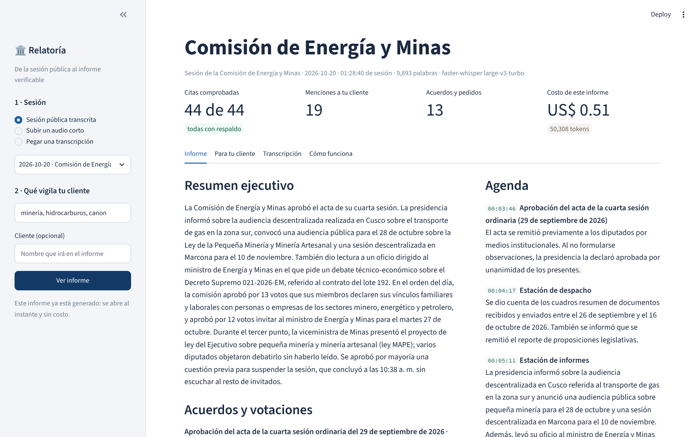
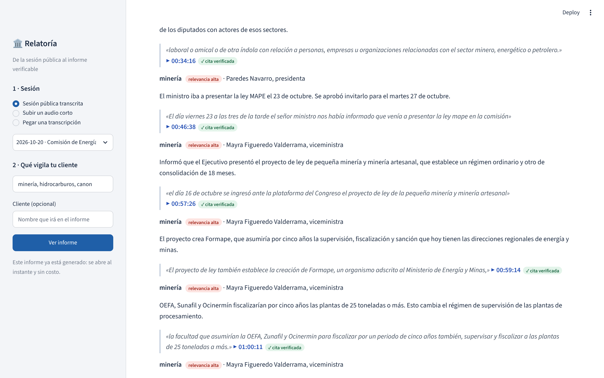
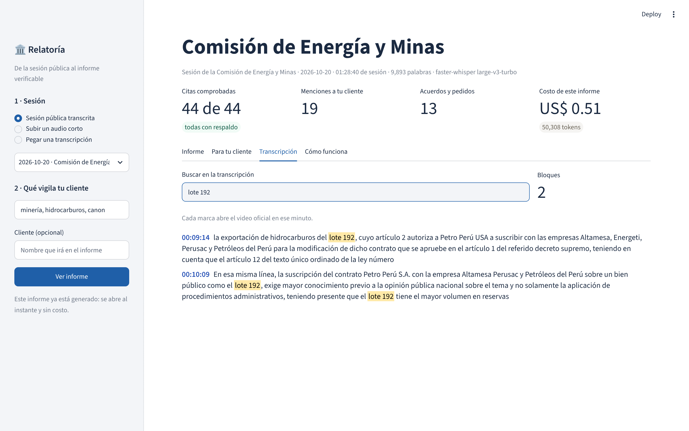
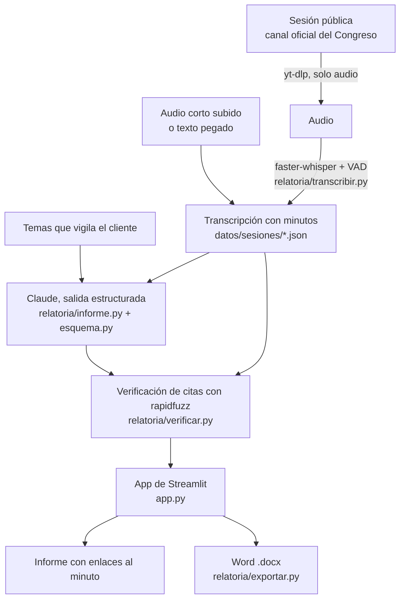

# Relatoría

> **Convertimos sesiones públicas del Congreso en informes verificables para consultoras de asuntos públicos,
> mediante transcripción con Whisper y un LLM con salidas estructuradas.**

Proyecto final de la Diplomatura de Data Science con Python (Q-Lab PUCP), [issue 204](https://github.com/d2cml-ai/Data-Science-Python/issues/204).

| | |
|---|---|
| Demo | **https://transcriptorcongressv2.streamlit.app** |
| Video de respaldo | [`docs/video_respaldo.mp4`](docs/video_respaldo.mp4) (62 s, grabado sobre la app con las sesiones reales) |
| Correr en local | `pip install -r requirements.txt && streamlit run app.py` |

## 1. One-liner

Hacemos **informes de sesiones del Congreso con cada cita enlazada al minuto del video** para **consultoras de
asuntos públicos** mediante **Whisper y un LLM con salidas estructuradas que un programa verifica**.

## 2. Founder

**Fabricio Luna Palacios**, economista (PUCP) y científico de datos. Trabajo como asistente en un despacho de la
Cámara de Diputados, donde parte de la rutina es seguir sesiones de comisión y dejar por escrito qué se acordó, quién
pidió qué y con qué plazo. Conozco el formato que espera quien lee esos informes y el tiempo que toma hacerlos a mano.
Antes construí las piezas técnicas por separado en este mismo repositorio: transcripción de audio en español peruano
con Whisper ([tarea 2](../tarea_2)) y agentes que no pueden inventar cifras porque todo sale de herramientas
verificables ([tarea 4](../tarea_4)).

El producto usa **solo sesiones públicas** del canal oficial del Congreso. No usa documentos ni información interna
de ningún despacho.

## 3. Problema

**Quién lo sufre.** Las consultoras de asuntos públicos y las áreas de asuntos regulatorios de empresas y gremios.
Su cliente quiere saber, el mismo día, qué se dijo sobre su sector en el Congreso.

**Cuánto le cuesta.** Una sesión de comisión dura entre 1 y 4 horas (las dos que se usan en el demo duran 68 y 89
minutos; otras sesiones de Energía y Minas de setiembre y octubre de 2026 superan las 3 horas y media). Con el Congreso
bicameral hay comisiones en dos cámaras. Alguien tiene que ver la sesión completa para encontrar los pocos minutos
que le importan al cliente y luego redactar el informe.

**Cómo lo resuelven hoy.** Un analista junior ve la transmisión, toma notas y redacta. Si dos sesiones coinciden, una
se ve en diferido. Los resúmenes automáticos genéricos no sirven porque el analista no puede citar ante su cliente
algo que no sabe en qué minuto se dijo, ni si se dijo.

**Evidencia.** Notas de tres conversaciones con usuarios potenciales en [`docs/research/`](docs/research/).

## 4. Solución e insight

0. **Sigues las comisiones de tu cliente.** La agenda lee el canal oficial del Congreso cada 5 minutos y muestra
   qué sesiones hubo, cuáles están **en vivo** y cuáles ya tienen informe. La selección queda en el enlace
   (`?sigo=Comisión de Salud&sigo=…`), así que se guarda en favoritos o se comparte con el equipo.
1. Eliges una sesión pública (o subes un audio, o pegas una transcripción).
2. Escribes qué vigila tu cliente: sectores, empresas, normas, entidades.
3. Recibes el informe: resumen ejecutivo, agenda, acuerdos y votaciones, pedidos con responsable y plazo,
   intervenciones y **todo lo que se dijo sobre los temas de tu cliente**, en pantalla y en Word.

**Insight.** Al consultor no le falta un resumen, le falta poder **confiar** en él sin volver a ver la sesión. Por eso
el modelo está obligado a entregar, junto a cada hallazgo, la frase literal y el minuto. Después un programa, no el
modelo, busca esa frase en la transcripción:

- si la encuentra, corrige el minuto con el lugar real y pone el enlace al video en ese segundo;
- si no la encuentra, la marca en rojo como «sin respaldo».

El analista pasa de ver tres horas a revisar los enlaces que le importan.

## 5. Why now

- **Transcripción.** Whisper large-v3-turbo transcribe una hora de español peruano en un par de minutos en una GPU
  doméstica, con un error que ya permite leer la sesión ([lo medí en la tarea 2](../tarea_2)). Hace tres años esto
  requería un servicio de pago por minuto.
- **Contexto largo.** Una sesión de hora y media son unas 31 mil tokens de entrada (medido); una de 3 horas, unas 60 mil. Hoy cabe completa en una sola llamada, de modo
  que el modelo ve un acuerdo que se abre en el minuto 20 y se cierra en el 150. Antes había que trocear y resumir por
  partes, y se perdían justo esos cruces.
- **Salidas estructuradas.** La API garantiza que la respuesta cumple un esquema. Eso permite exigir «cita y minuto» en
  cada ítem y verificarlo con código.
- **Costo.** El informe de una sesión de hora y media costó US$ 0.51 (ver sección 7).
- **Congreso bicameral desde julio de 2026.** Más comisiones y más sesiones simultáneas que seguir con el mismo equipo.

## 6. Demo

**URL:** https://transcriptorcongressv2.streamlit.app (Streamlit Community Cloud). Los informes de las dos sesiones ya están generados y se abren sin costo; generar uno nuevo usa la API.

**En local:**

```bash
cd proyecto_final
pip install -r requirements.txt
export ANTHROPIC_API_KEY=...        # o .streamlit/secrets.toml; ver .env.example
streamlit run app.py
```

**Transcribir una sesión completa** (fuera de línea, idealmente con GPU):

```bash
pip install -r requirements-dev.txt
python pipeline/transcribir_sesion.py "https://www.youtube.com/watch?v=LvsY8hVx-ec" \
    --organo "Comisión de Economía, Banca, Finanzas e Inteligencia Financiera (Diputados)"
python pipeline/generar_informe.py LvsY8hVx-ec --temas "sistema financiero" "AFP" "tasas de interés"
```

**Seguir comisiones sin intervenir** (el vigilante). Cada ronda actualiza `datos/catalogo.json`, busca las sesiones
terminadas de tus comisiones que aún no están transcritas, las transcribe y, con `--temas`, genera el informe. Las
que siguen en vivo quedan para la ronda siguiente. Con `--publicar` hace `git commit` y `push` de lo nuevo a la rama
en la que está el repositorio. La sesión aparece como **transcrita** en la agenda cuando la app toma ese commit: en
las pruebas del 11/11/2026 Streamlit Cloud no lo tomó sola y hubo que reiniciarla («Reboot app»).

```bash
# qué haría, sin descargar nada
python pipeline/vigilar.py --comisiones "Comisión de Energía y Minas" "Comisión de Salud" --simular
# sin parar, cada 10 minutos, con informe y publicación
python pipeline/vigilar.py --comisiones "Comisión de Energía y Minas" --palabras Petroperú \
    --temas minería canon --cada 600 --publicar
```

**De dónde sale la agenda.** Del feed RSS público del canal (las 15 emisiones más recientes, sin clave), de la
página de cada video (si sigue en vivo y cuánto duró) y, en el vigilante, del listado de transmisiones con
`yt-dlp`. El nombre de la comisión y la cámara se leen del título; como el canal titula la misma comisión de varias
formas («Defensa Nacional» y «Defensa Nacional y Orden Interno»), las variantes se agrupan bajo un solo nombre.
Límite: si una comisión del Senado y otra de Diputados se llaman igual, la agenda las sigue juntas y las distingue
con la etiqueta de cámara.

**Capturas** (sesión de la Comisión de Energía y Minas del 20 de octubre de 2026, 89 minutos):







**Sesiones del demo** (canal oficial del Congreso de la República):

| Sesión | Duración | Palabras | Citas del informe con respaldo |
|---|---|---|---|
| [Comisión de Energía y Minas, 20/10/2026](https://www.youtube.com/watch?v=2EIYKlqJBT8) | 1 h 29 min | 9 893 | 44 de 44 |
| [Comisión de Economía, Banca, Finanzas e Inteligencia Financiera (Diputados), 28/10/2026](https://www.youtube.com/watch?v=LvsY8hVx-ec) | 1 h 08 min | 7 827 | 22 de 22 |

La transcripción de la sesión de 89 minutos tomó 4.1 minutos en una GPU doméstica (21.7 veces más rápido que el audio).

**Arquitectura**



**Modelos y APIs, y por qué**

| Pieza | Modelo o API | Por qué |
|---|---|---|
| Voz a texto | faster-whisper `large-v3-turbo` fuera de línea; `base` en la app | Abierto, corre en mi máquina sin costo por minuto y da tiempos por segmento. En Streamlit Cloud (1 GB de RAM, sin GPU) solo cabe un modelo pequeño, por eso allí se limita a audios cortos |
| Informe | Claude (`claude-opus-5-5`) por la API de Anthropic, con salida estructurada | Lee la sesión entera en una llamada y devuelve el esquema de Pydantic sin texto suelto que haya que limpiar |
| Verificación | `rapidfuzz` (coincidencia aproximada) | Determinista y gratis; tolera tildes y comas distintas, pero no una paráfrasis |
| Documento | `python-docx` | El entregable de una consultora es un Word |

**Límites conocidos.** No reconoce a los oradores por la voz: usa el nombre con que se les da la palabra. Whisper se
equivoca en apellidos y cifras, y por eso cada cita lleva el enlace para confirmarla. La verificación comprueba que la
frase se dijo, no que el resumen que la acompaña sea la mejor lectura de ella.

## 7. Modelo de negocio

**Quién paga.** La consultora (o el área de asuntos públicos de una empresa o gremio), por suscripción mensual.

**Precio.** **S/ 890 al mes** por el seguimiento de hasta 20 sesiones, con los temas de hasta 3 clientes. Sesiones
adicionales a **S/ 60** cada una.

**Costo por sesión, medido** en las dos sesiones del demo (tokens que reporta la API; Claude Opus 5.5 a US$ 4 por
millón de tokens de entrada y US$ 20 por millón de salida):

| Sesión | Tokens de entrada | Tokens de salida | Costo del informe |
|---|---|---|---|
| Economía, 68 min | 24 863 | 11 100 | US$ 0.32 |
| Energía y Minas, 89 min | 30 841 | 19 467 | US$ 0.51 |

Son unos US$ 0.30 a 0.35 por hora de sesión. La transcripción corre en GPU propia (4 minutos por sesión) y la app en
Streamlit Community Cloud, sin costo. Un cliente que usa sus 20 sesiones cuesta cerca de US$ 10 al mes en tokens,
frente a los S/ 890 que paga. Para una sesión de 3 horas el costo se estima en alrededor de US$ 1 (extrapolado, no
medido). La app muestra el costo real de cada informe.

**Tope de gasto.** La app limita los informes nuevos por visita, guarda los ya generados para no pagarlos dos veces,
rechaza transcripciones de más de 120 mil palabras y puede pedir un código de acceso (`RELATORIA_CODIGO`). La clave
tiene además un límite mensual en la consola de Anthropic.

## 8. Herramientas del curso

| Sesión del curso | Herramienta | Archivo |
|---|---|---|
| 13 · Voz | Whisper (faster-whisper con VAD e `initial_prompt`) | [`relatoria/transcribir.py`](relatoria/transcribir.py), [`pipeline/transcribir_sesion.py`](pipeline/transcribir_sesion.py) |
| 08 · LLMs | Salidas estructuradas con Pydantic | [`relatoria/esquema.py`](relatoria/esquema.py), [`relatoria/informe.py`](relatoria/informe.py) |
| 05 y 12 · Dashboards y despliegue | App de Streamlit desplegada | [`app.py`](app.py) |

## 9. Qué hizo el agente

Trabajé con Claude Code. La idea, el usuario, el alcance (solo sesiones públicas), el formato del informe y las
conversaciones con usuarios son míos. Claude Code escribió, a partir de un plan que revisé y aprobé:

- el esquema del informe y el *prompt* de sistema (`relatoria/esquema.py`, `relatoria/informe.py`);
- la verificación de citas (`relatoria/verificar.py`) y sus pruebas (`tests/`);
- la exportación a Word (`relatoria/exportar.py`);
- la app (`app.py`) y los scripts de `pipeline/`;
- el borrador de este README.

Decisiones que tomé o corregí yo:

- **El producto y el usuario.** De cuatro ideas posibles elegí «sesiones a informe» para consultoras, porque es el
  trabajo que conozco de primera mano. Descarté una ficha territorial con ENAHO y BCRP porque se parecía a otros
  proyectos del curso.
- **La pila técnica.** Elegí la API de Claude y Streamlit Community Cloud, y dejar el proyecto en este repositorio.
- **Las sesiones y los temas del demo.** Transcribí las dos sesiones en mi GPU. Al revisar el primer informe vi que la
  sesión de Economía no tocaba AFP ni tasas de interés, y usé la de Energía y Minas como caso principal del demo.
- **La seguridad de la clave.** Una clave de la API quedó escrita en `app.py` por error. La revoqué, creé una nueva y
  la configuré solo en los *secrets* de Streamlit.

Lo que el agente no pudo hacer: descargar el audio desde su entorno (YouTube lo bloquea), así que la transcripción de
las sesiones completas la corrí en mi máquina con `pipeline/transcribir_sesion.py`.

## Estructura

```
proyecto_final/
├── app.py                    app de Streamlit
├── relatoria/
│   ├── esquema.py            qué debe devolver el LLM
│   ├── transcribir.py        audio → segmentos con tiempo (Whisper)
│   ├── transcripcion.py      formato de la transcripción y marcas de tiempo
│   ├── informe.py            transcripción → informe (Claude)
│   ├── verificar.py          ¿cada cita está en la transcripción?
│   ├── exportar.py           informe → .docx
│   ├── almacen.py            informes ya generados
│   └── agenda.py             canal oficial → catálogo de sesiones y seguimiento de comisiones
├── pipeline/                 transcribir sesiones, pregenerar informes y vigilar el canal (vigilar.py)
├── datos/catalogo.json       sesiones del canal vistas hasta ahora (crece solo)
├── datos/sesiones/           transcripciones de sesiones públicas
├── datos/informes/           informes ya generados
├── docs/research/            notas de conversaciones con usuarios
└── tests/                    27 pruebas, sin red ni clave: pytest tests -q
```
