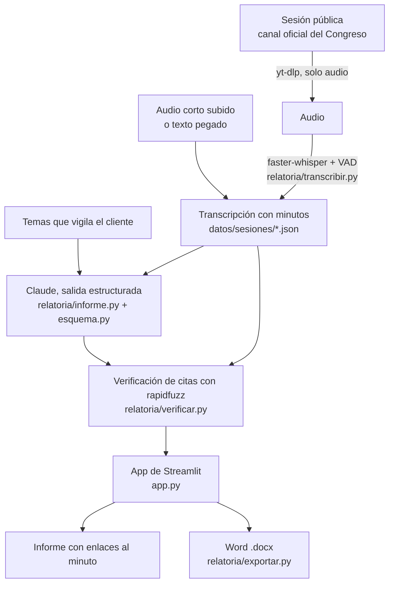

# Relatoría

> **Convertimos sesiones públicas del Congreso en informes verificables para consultoras de asuntos públicos,
> mediante transcripción con Whisper y un LLM con salidas estructuradas.**

Proyecto final de la Diplomatura de Data Science con Python (Q-Lab PUCP), [issue 204](https://github.com/d2cml-ai/Data-Science-Python/issues/204).

| | |
|---|---|
| Demo | **PENDIENTE: URL de Streamlit Community Cloud** |
| Video de respaldo | **PENDIENTE** (`docs/video_respaldo.mp4`) |
| Correr en local | `pip install -r requirements.txt && streamlit run app.py` |

## 1. One-liner

Hacemos **informes de sesiones del Congreso con cada cita enlazada al minuto del video** para **consultoras de
asuntos públicos** mediante **Whisper y un LLM con salidas estructuradas que un programa verifica**.

## 2. Founder

**Fabricio Luna Palacios**, economista (PUCP) y científico de datos. Trabajo como asistente en un despacho de la
Cámara de Diputados, donde parte de la rutina es seguir sesiones de comisión y dejar por escrito qué se acordó, quién
pidió qué y con qué plazo. Conozco el formato que espera quien lee esos informes y el tiempo que toma hacerlos a mano.
Antes construí las piezas técnicas por separado en este mismo repositorio: transcripción de audio en español peruano
con Whisper ([tarea 2](../tarea_2)) y agentes que no pueden inventar cifras porque todo sale de herramientas
verificables ([tarea 4](../tarea_4)).

El producto usa **solo sesiones públicas** del canal oficial del Congreso. No usa documentos ni información interna
de ningún despacho.

## 3. Problema

**Quién lo sufre.** Las consultoras de asuntos públicos y las áreas de asuntos regulatorios de empresas y gremios.
Su cliente quiere saber, el mismo día, qué se dijo sobre su sector en el Congreso.

**Cuánto le cuesta.** Una sesión de comisión dura entre 1 y 4 horas (las dos que se usan en el demo duran 68 y 89
minutos; las de Energía y Minas de setiembre y octubre de 2026 superan las 3 horas y media). Con el Congreso
bicameral hay comisiones en dos cámaras. Alguien tiene que ver la sesión completa para encontrar los pocos minutos
que le importan al cliente y luego redactar el informe.

**Cómo lo resuelven hoy.** Un analista junior ve la transmisión, toma notas y redacta. Si dos sesiones coinciden, una
se ve en diferido. Los resúmenes automáticos genéricos no sirven porque el analista no puede citar ante su cliente
algo que no sabe en qué minuto se dijo, ni si se dijo.

**Evidencia.** Notas de tres conversaciones con usuarios potenciales en [`docs/research/`](docs/research/).

## 4. Solución e insight

1. Eliges una sesión pública (o subes un audio, o pegas una transcripción).
2. Escribes qué vigila tu cliente: sectores, empresas, normas, entidades.
3. Recibes el informe: resumen ejecutivo, agenda, acuerdos y votaciones, pedidos con responsable y plazo,
   intervenciones y **todo lo que se dijo sobre los temas de tu cliente**, en pantalla y en Word.

**Insight.** Al consultor no le falta un resumen, le falta poder **confiar** en él sin volver a ver la sesión. Por eso
el modelo está obligado a entregar, junto a cada hallazgo, la frase literal y el minuto. Después un programa, no el
modelo, busca esa frase en la transcripción:

- si la encuentra, corrige el minuto con el lugar real y pone el enlace al video en ese segundo;
- si no la encuentra, la marca en rojo como «sin respaldo».

El analista pasa de ver tres horas a revisar los enlaces que le importan.

## 5. Why now

- **Transcripción.** Whisper large-v3-turbo transcribe una hora de español peruano en un par de minutos en una GPU
  doméstica, con un error que ya permite leer la sesión ([lo medí en la tarea 2](../tarea_2)). Hace tres años esto
  requería un servicio de pago por minuto.
- **Contexto largo.** Una sesión de 3 horas son unas 60 mil tokens. Hoy cabe completa en una sola llamada, de modo
  que el modelo ve un acuerdo que se abre en el minuto 20 y se cierra en el 150. Antes había que trocear y resumir por
  partes, y se perdían justo esos cruces.
- **Salidas estructuradas.** La API garantiza que la respuesta cumple un esquema. Eso permite exigir «cita y minuto» en
  cada ítem y verificarlo con código.
- **Costo.** Leer una sesión completa cuesta centavos de dólar (ver sección 7).
- **Congreso bicameral desde julio de 2026.** Más comisiones y más sesiones simultáneas que seguir con el mismo equipo.

## 6. Demo

**URL:** PENDIENTE.

**En local:**

```bash
cd proyecto_final
pip install -r requirements.txt
export ANTHROPIC_API_KEY=...        # o .streamlit/secrets.toml; ver .env.example
streamlit run app.py
```

**Transcribir una sesión completa** (fuera de línea, idealmente con GPU):

```bash
pip install -r requirements-dev.txt
python pipeline/transcribir_sesion.py "https://www.youtube.com/watch?v=LvsY8hVx-ec" \
    --organo "Comisión de Economía, Banca, Finanzas e Inteligencia Financiera (Diputados)"
python pipeline/generar_informe.py LvsY8hVx-ec --temas "sistema financiero" "AFP" "tasas de interés"
```

**Capturas:** PENDIENTE (`docs/capturas/`).

**Arquitectura**



**Modelos y APIs, y por qué**

| Pieza | Modelo o API | Por qué |
|---|---|---|
| Voz a texto | faster-whisper `large-v3-turbo` fuera de línea; `base` en la app | Abierto, corre en mi máquina sin costo por minuto y da tiempos por segmento. En Streamlit Cloud (1 GB de RAM, sin GPU) solo cabe un modelo pequeño, por eso allí se limita a audios cortos |
| Informe | Claude (`claude-opus-5-5`) por la API de Anthropic, con salida estructurada | Lee la sesión entera en una llamada y devuelve el esquema de Pydantic sin texto suelto que haya que limpiar |
| Verificación | `rapidfuzz` (coincidencia aproximada) | Determinista y gratis; tolera tildes y comas distintas, pero no una paráfrasis |
| Documento | `python-docx` | El entregable de una consultora es un Word |

**Límites conocidos.** No reconoce a los oradores por la voz: usa el nombre con que se les da la palabra. Whisper se
equivoca en apellidos y cifras, y por eso cada cita lleva el enlace para confirmarla. La verificación comprueba que la
frase se dijo, no que el resumen que la acompaña sea la mejor lectura de ella.

## 7. Modelo de negocio

**Quién paga.** La consultora (o el área de asuntos públicos de una empresa o gremio), por suscripción mensual.

**Precio.** **S/ 890 al mes** por el seguimiento de hasta 20 sesiones, con los temas de hasta 3 clientes. Sesiones
adicionales a **S/ 60** cada una.

**Costo por sesión** (sesión de 3 horas, unas 60 mil tokens de entrada y 8 mil de salida):

| Concepto | Cálculo | Costo |
|---|---|---|
| Informe con Claude Opus 5.5 | 60 000 × US$ 4/M + 8 000 × US$ 20/M | US$ 0.40 |
| Transcripción con Whisper en GPU alquilada | ~6 min de GPU a US$ 0.50 la hora | US$ 0.05 |
| Servidor de la app | Streamlit Community Cloud | US$ 0 |
| **Total por sesión** | | **≈ US$ 0.45 (S/ 1.70)** |

Un cliente que usa sus 20 sesiones cuesta cerca de S/ 34 al mes en tokens y cómputo. La app muestra el costo real
de cada informe a partir de los tokens que reporta la API. **PENDIENTE: reemplazar la estimación por el costo medido
en las sesiones del demo.**

**Tope de gasto.** La app limita los informes nuevos por visita, guarda los ya generados para no pagarlos dos veces,
rechaza transcripciones de más de 120 mil palabras y puede pedir un código de acceso (`RELATORIA_CODIGO`). La clave
tiene además un límite mensual en la consola de Anthropic.

## 8. Herramientas del curso

| Sesión del curso | Herramienta | Archivo |
|---|---|---|
| 13 · Voz | Whisper (faster-whisper con VAD e `initial_prompt`) | [`relatoria/transcribir.py`](relatoria/transcribir.py), [`pipeline/transcribir_sesion.py`](pipeline/transcribir_sesion.py) |
| 08 · LLMs | Salidas estructuradas con Pydantic | [`relatoria/esquema.py`](relatoria/esquema.py), [`relatoria/informe.py`](relatoria/informe.py) |
| 05 y 12 · Dashboards y despliegue | App de Streamlit desplegada | [`app.py`](app.py) |

## 9. Qué hizo el agente

Trabajé con Claude Code. La idea, el usuario, el alcance (solo sesiones públicas), el formato del informe y las
conversaciones con usuarios son míos. Claude Code escribió, a partir de un plan que revisé y aprobé:

- el esquema del informe y el *prompt* de sistema (`relatoria/esquema.py`, `relatoria/informe.py`);
- la verificación de citas (`relatoria/verificar.py`) y sus pruebas (`tests/`);
- la exportación a Word (`relatoria/exportar.py`);
- la app (`app.py`) y los scripts de `pipeline/`;
- el borrador de este README.

Decisiones que tomé o corregí yo: PENDIENTE (completar tras revisar el código).

Lo que el agente no pudo hacer: descargar el audio desde su entorno (YouTube lo bloquea), así que la transcripción de
las sesiones completas la corrí en mi máquina con `pipeline/transcribir_sesion.py`.

## Estructura

```
proyecto_final/
├── app.py                    app de Streamlit
├── relatoria/
│   ├── esquema.py            qué debe devolver el LLM
│   ├── transcribir.py        audio → segmentos con tiempo (Whisper)
│   ├── transcripcion.py      formato de la transcripción y marcas de tiempo
│   ├── informe.py            transcripción → informe (Claude)
│   ├── verificar.py          ¿cada cita está en la transcripción?
│   ├── exportar.py           informe → .docx
│   └── almacen.py            informes ya generados
├── pipeline/                 transcribir sesiones completas y pregenerar informes
├── datos/sesiones/           transcripciones de sesiones públicas
├── datos/informes/           informes ya generados
├── docs/research/            notas de conversaciones con usuarios
└── tests/                    15 pruebas, sin red ni clave: pytest tests -q
```
