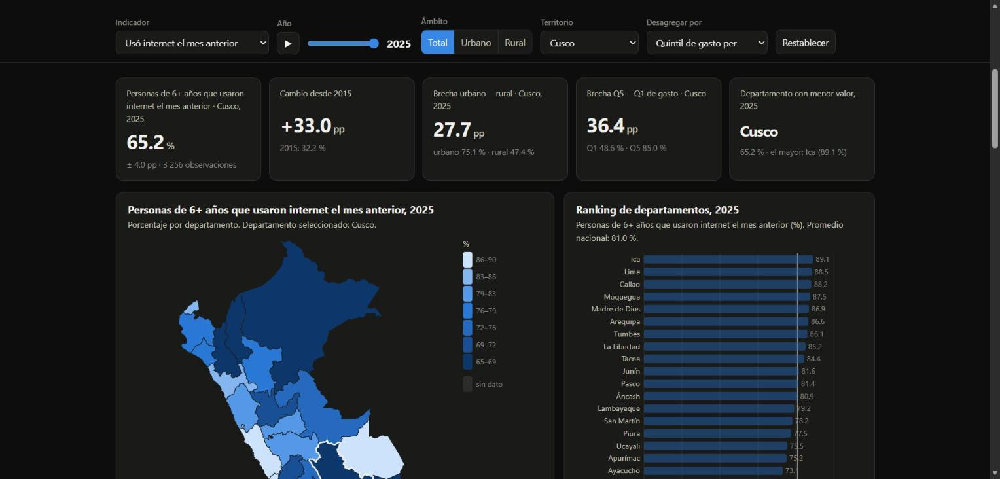
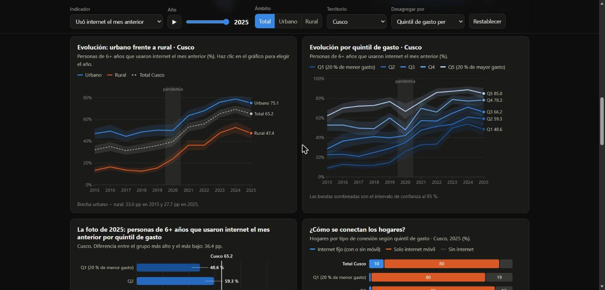

# Tarea 3: la brecha digital en el Perú, 2015–2025

> **Pregunta de investigación:** ¿cuánto se cerró la brecha digital en el Perú entre 2015 y 2025, y entre quiénes sigue
> abierta: por territorio, área de residencia, edad, lengua materna y nivel de gasto?

| Producto | Enlace |
|---|---|
| Dashboard público | **https://faluna22.github.io/Data-Science-Python-Tareas/tarea_3/web/** |
| Reel (1080×1920) | [`reel/reel.mp4`](reel/reel.mp4) |
| Publicación de LinkedIn | _pendiente: se agrega al publicar_ |



## 1. Tema y pregunta

En diez años, el porcentaje de peruanos de 6 años a más que usa internet se duplicó. El proyecto mide cuánto se cerró
la brecha digital y a quiénes dejó atrás, con los microdatos de la Encuesta Nacional de Hogares (ENAHO) del INEI.
**Cobertura:** Perú, 25 departamentos (Lima y Callao por separado), área urbana y rural, 2015–2025 (11 encuestas anuales).

## 2. Descripción

- **Datos:** 378,811 hogares y 1,173,208 personas de 6 años a más, procesados desde los módulos 01, 03 y 34 de la ENAHO.
- **Dashboard** (`web/`): página estática con D3.js, publicada en GitHub Pages. Tiene 5 KPIs y 6 visualizaciones: mapa
  coroplético, ranking de departamentos, series urbano/rural, series por grupo, barras con margen de error y tipo de
  conexión por quintil. Tiene 6 controles: indicador, año (con animación), ámbito, territorio (también se elige con un
  clic en el mapa) y desagregación, más un botón para restablecer. Se puede descargar en CSV la selección, ver la tabla
  de datos, cambiar entre modo claro y oscuro, y compartir la vista por URL.
- **Reel** (`reel/`): 6 escenas narradas con voz clonada (Qwen3-TTS) a partir de mi propia voz, con mapa y gráficos
  animados, recorrido por el dashboard, subtítulos sincronizados (Whisper), música original y créditos.

## 3. Fuentes y metodología

| Fuente | Uso |
|---|---|
| INEI, [ENAHO](https://proyectos.inei.gob.pe/microdatos/) 2015–2025, módulo 01 (vivienda y hogar) | Celular, teléfono fijo, internet del hogar y tipo de conexión (desde 2023) |
| INEI, ENAHO 2015–2025, módulo 03 (educación) | Uso de internet de cada persona (`p314a`), frecuencia y dispositivo |
| INEI, ENAHO 2015–2025, módulo 34 (sumaria) | Pobreza, gasto per cápita (quintiles) y factor del hogar |
| INEI, [Informe técnico de pobreza monetaria 2016–2025](https://www.gob.pe/institucion/inei/informes-publicaciones/8087825-cifras-de-pobreza-2025) | Validación |
| INEI, informes trimestrales de TIC en los hogares ([III trim. 2024](https://andina.pe/agencia/noticia-inei-uso-internet-alcanzo-al-802-de-poblacion-6-y-mas-anos-edad-1012997.aspx), [IV trim. 2025](https://elperuano.pe/noticia/292141-lima-metropolitana-el-984-de-hogares-conto-con-telefonia-movil-durante-cuarto-trimestre-de-2025)) | Validación |
| [GeoJSON departamental](https://github.com/d2cml-ai/Data-Science-Python/tree/main/sessions/06-geoespacial) del curso | Mapa |

Microdatos descargados el 8 de noviembre de 2026. Códigos de encuesta del INEI: 498, 546, 603, 634, 687, 737, 759, 784,
906, 966 y 1031.

**Procesamiento** (`scripts/procesar_datos.py`)
- **Personas:** residentes habituales de 6 años a más (`p204`, `p205`, `p206`), ponderados con `factora07`.
- **Hogares:** los que están en la sumaria, ponderados con `factor07`.
- **Área:** estratos 1–5 urbano y 6–8 rural. **Departamento:** dos primeros dígitos del ubigeo.
- **Quintil:** gasto per cápita (`gashog2d / mieperho`) ponderado por personas, calculado cada año.
- **Lengua indígena:** quechua, aimara y lenguas amazónicas (`p300a`).
- **Año 2020:** de abril a septiembre no se preguntó la frecuencia ni el dispositivo, así que esos casos quedan como
  dato faltante, no como "no usa".

**Indicadores** (`scripts/analizar_datos.py`)
- Cada indicador es una proporción ponderada, con margen de error al 95 % linealizado por conglomerado (`conglome`).
- No se publican celdas con menos de 30 observaciones.

**Validación** ([`datos/procesados/validacion.txt`](datos/procesados/validacion.txt))

| Cifra | Propia | INEI |
|---|---|---|
| Pobreza monetaria 2024 | 27.58 % | 27.6 % |
| Pobreza monetaria 2025 | 25.67 % | 25.7 % |
| Hogares con internet 2015 | 23.17 % | 23.2 % |
| Uso de internet 2025 | 81.0 % (anual) | 82.0 % (IV trimestre) |

## 4. Hallazgos

1. **El campo se conectó, y la pandemia aceleró el salto.** El uso de internet de la población rural pasó de **11.2 %
   (2015) a 61.3 % (2025)**, y a nivel nacional de 40.8 % a 81.0 %. La brecha urbano-rural bajó de 38.4 a 24.0 puntos.
   El mayor salto rural fue entre 2019 y 2020 (+13.7 pp).
2. **La brecha cambió de forma: de tener internet a cómo se tiene.**
   - En 2025, el **64 % de los hogares solo tiene internet móvil**; en el campo, el 79 %.
   - Solo el **6.7 %** de los hogares del quintil más pobre tiene internet fijo, frente al **47.2 %** del más rico.
   - El 4.1 % del quintil más pobre usa internet desde una computadora, frente al 44.2 % del quintil más rico.
3. **Quienes siguen fuera.**
   - Solo el **13.3 % de los adultos mayores rurales** (65+) usa internet.
   - Entre quienes tienen una lengua materna indígena, el uso es de 63.6 %, frente a 84.2 % entre castellanohablantes.
   - Cusco (65.2 %), Cajamarca (67.4 %) y Puno (67.9 %) están más de 20 puntos por debajo de Lima (88.5 %) e Ica (89.1 %).

**Dato complementario:** el uso de los niños de 6 a 11 años saltó de 35 % (2019) a 72 % (2021) con las clases virtuales,
y cayó a 56 % en 2022.



## 5. Limitaciones

- **Quiebre de serie en 2023 en "hogares con internet":** desde ese año la pregunta incluye el internet móvil (de 55 % a
  90 %). La comparación de largo plazo usa el uso individual (`p314a`), cuya pregunta no cambió.
- **2020 es atípico:** hubo encuestas telefónicas. Los indicadores de frecuencia y dispositivo de ese año son
  referenciales.
- La ENAHO mide si una persona usó internet, no la calidad, la velocidad ni el costo de la conexión, ni las habilidades
  digitales.
- Hay celdas pequeñas (por ejemplo, el área rural de Lima y Callao, o la lengua indígena en la costa) con márgenes amplios
  u ocultas.
- Las diferencias son descriptivas, no causales. La lengua indígena, por ejemplo, coincide con la ruralidad y la pobreza.

## 6. Enlaces

- Dashboard: https://faluna22.github.io/Data-Science-Python-Tareas/tarea_3/web/
- Repositorio: https://github.com/FaLuna22/Data-Science-Python-Tareas/tree/main/tarea_3
- LinkedIn: _pendiente_

## 7. Cómo reproducir

```bash
cd tarea_3
uv sync                                  # o: python -m venv .venv && pip install pandas pyarrow matplotlib numpy
uv run python scripts/obtener_datos.py   # ~520 MB de microdatos en datos/originales/ (ignorado por git)
uv run python scripts/procesar_datos.py  # datos/procesados/hogares.parquet y personas.parquet
uv run python scripts/analizar_datos.py  # indicadores.csv, validacion.txt y web/data/*.json
cd web && python -m http.server 8000     # http://localhost:8000
```

Reel, con un entorno propio porque `qwen-tts` fija su versión de `transformers`:

```bash
cd reel
uv venv .venv --python 3.12 && uv pip install --python .venv/Scripts/python.exe -r requirements.txt
.venv/Scripts/python.exe musica.py 90                     # música de fondo original
.venv/Scripts/python.exe hacer_reel.py --preview          # sin voz, para revisar los visuales
.venv/Scripts/python.exe hacer_reel.py --voz recursos/voz_referencia_20s.wav --url <dashboard>
```

La grabación de voz no se sube al repositorio. `voz_sesion15.py` es el módulo `reel.py` de la
[Sesión 15](https://github.com/d2cml-ai/Data-Science-Python/tree/main/sessions/15-texto-a-reel) del curso, sin cambios.

## 8. Uso de inteligencia artificial

- Usé **Claude Code** para escribir los scripts de descarga, limpieza y análisis, el dashboard y el montaje del reel.
- Verifiqué las cifras contra los datos y contra las publicaciones oficiales del INEI (sección 3). Los quiebres de serie
  de 2020 y 2023 los detecté al revisar los resultados y están documentados.
- La narración del reel la generó **Qwen3-TTS** a partir de una grabación de mi propia voz. Los subtítulos los generó
  **Whisper** large-v3-turbo. La música es una pista original generada con código (`reel/musica.py`), sin derechos de
  terceros.

## Estructura

```text
tarea_3/
├── README.md
├── pyproject.toml, uv.lock
├── scripts/      obtener_datos.py · procesar_datos.py · analizar_datos.py
├── datos/        originales/ (ignorado) · procesados/indicadores.csv, validacion.txt
├── web/          index.html · assets/ (style.css, app.js, img/) · data/ (nacional.json, departamentos/, geojson)
└── reel/         guion.json · hacer_reel.py · voz_sesion15.py · musica.py · subtitulos.srt · reel.mp4 · portada.png
```
