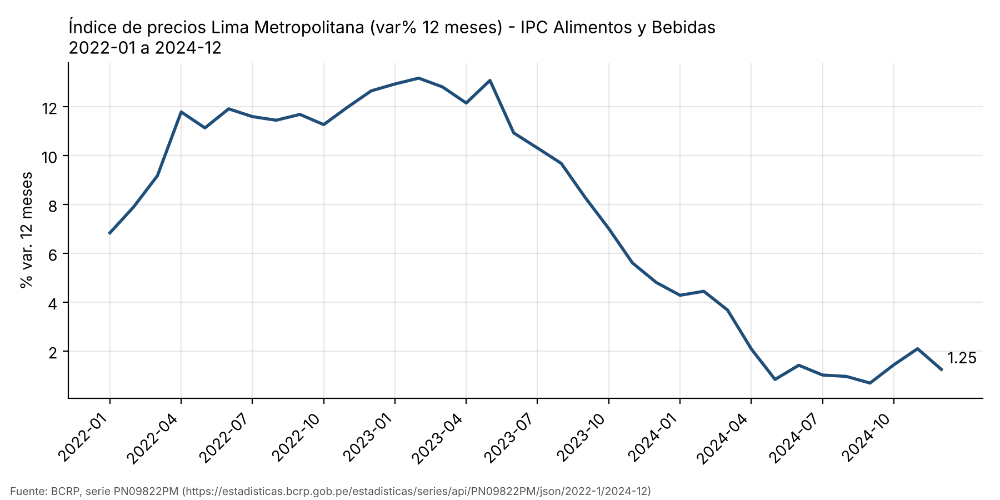
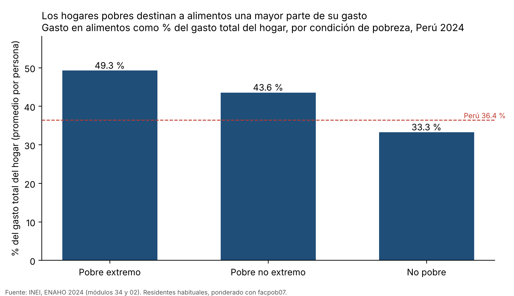
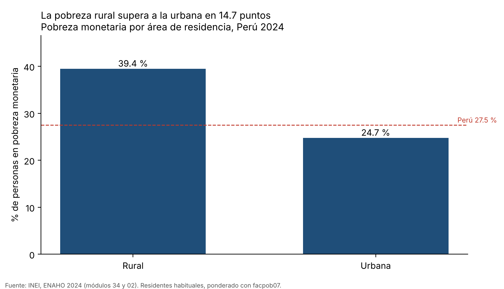
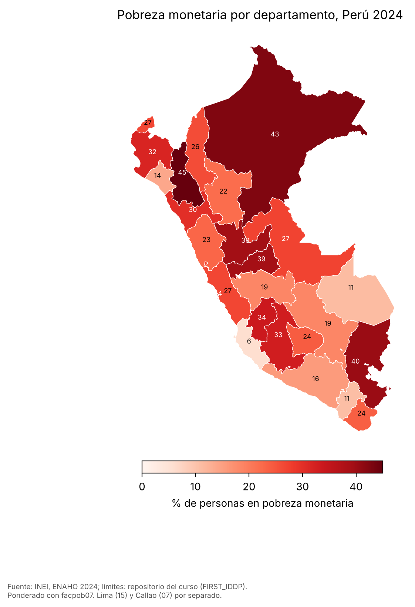
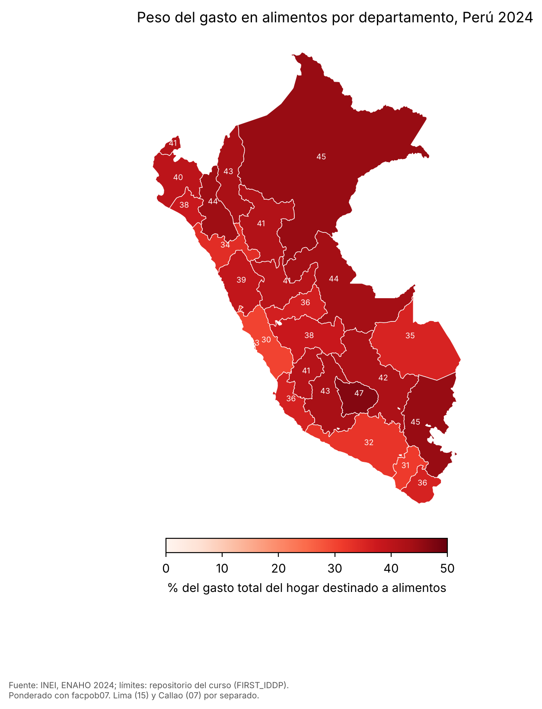

# ¿Qué tan expuestos estuvieron los hogares pobres del Perú a la inflación de alimentos?

**Tarea 4: agente de investigación socioeconómica (BCRP + ENAHO 2024)**

> Las cifras salen de herramientas que se pueden volver a correr: el servidor MCP `bcrp` (`mcp/server.py`), las skills
> `limpiando-enaho`, `graficando-enaho` y `mapeando-enaho` (`.claude/skills/`) y `scripts/cruce.py`. El borrador lo
> escribió el agente en una sola ejecución de Claude Code
> ([`evidencias_ia/integracion/ejecucion_integrada.md`](../evidencias_ia/integracion/ejecucion_integrada.md)), que
> usó 4 herramientas MCP y 3 skills. Ese borrador está en
> [`informes/borrador_agente.md`](borrador_agente.md). Esta versión lo ordena, agrega el cruce entre las dos fuentes y
> la verificación manual.

## 1. Pregunta de investigación

**Tema.** Entre 2022 y 2023 los precios de los alimentos subieron mucho más rápido que el resto de la canasta. Ese
choque no pesa igual en todos los hogares. Pesa más en los que dedican una mayor parte de su presupuesto a comer.

**Pregunta.** ¿Qué tan expuestos estuvieron los hogares pobres a la inflación de alimentos? Se compara la inflación de
alimentos y bebidas que mide el BCRP (2022–2024) con la pobreza monetaria y el peso del gasto en alimentos de los
hogares en la ENAHO 2024, por área, condición de pobreza y departamento.

**Objetivo.** Medir cuánto pesan los alimentos en el gasto de cada grupo. Con eso se estima cuántos puntos de su gasto
total habría encarecido la inflación de alimentos observada.

**Alcance.** El análisis es descriptivo y de un solo año de la ENAHO (2024). No mide el efecto causal de la inflación
sobre la pobreza.

## 2. Fuentes y metodología

| Fuente | Qué se usó | Cómo se obtuvo |
|---|---|---|
| BCRP, serie `PN09822PM` | IPC de Alimentos y Bebidas, Lima Metropolitana, variación % 12 meses, 2022-01 a 2024-12 | MCP: `buscar_series` → `resumen` → `graficar_serie` |
| BCRP, serie `PN01273PM` | IPC total, Lima Metropolitana, variación % 12 meses | MCP: `resumen`, `correlacion` con `PN09822PM` |
| INEI, ENAHO 2024, módulo 34 (sumaria) | pobreza, `factor07`, `mieperho`, `gashog2d`, grupo 1 de gasto (`gru11hd`–`gru14hd6`), `estrato`, `ubigeo` | skill `limpiando-enaho` |
| INEI, ENAHO 2024, módulo 02 (miembros) | residentes habituales (`p204`–`p206`), sexo, edad, `facpob07` | skill `limpiando-enaho` |
| GeoJSON departamental del curso | 25 polígonos con `FIRST_IDDP` | skill `mapeando-enaho` |

**Procesamiento ENAHO.** El script `limpiar.py`:

1. Lee los `.dta` con las llaves como texto.
2. Filtra a los residentes habituales: `((p204==1)&(p205==2))|((p204==2)&(p206==1))`. Quedan 108,664 personas.
3. Une personas con hogares con `merge(validate="m:1")`.
4. Construye `departamento = ubigeo[:2]`, `urbano = estrato <= 5` y `pobre = pobreza <= 2`.
5. Calcula el peso de los alimentos: el gasto del grupo 1 (en todas las formas de adquisición, dentro y fuera del
   hogar) dividido entre `gashog2d`.

Todas las cifras de personas se ponderan con `facpob07`. Las validaciones están en
[`salidas/validacion.txt`](../salidas/validacion.txt) y todas pasan:

| Validación | Resultado |
|---|---|
| Residentes habituales | 108,664 |
| Departamentos | 25 de 25 |
| Unión m:1 | sin filas perdidas ni duplicadas |
| Pobreza nacional | 27.53 % (27.58 % con `factor07 × mieperho`; INEI: 27.6 %) |
| Pobreza urbana / rural | 24.74 % / 39.44 % |

**Indicador de exposición** (en [`scripts/cruce.py`](../scripts/cruce.py)):

> exposición (puntos del gasto total) = inflación de alimentos a 12 meses × peso de los alimentos en el gasto / 100

Es una aproximación de primer orden. Dice cuánto habría subido el costo de la canasta total de un grupo solo por el
alza de los alimentos, si ese grupo no cambiara lo que compra.

## 3. Resultados

### Hallazgo 1. La inflación de alimentos fue más alta y más persistente que la inflación total

Según la serie `PN09822PM`, la inflación de alimentos y bebidas de Lima llegó a **13.16 % en febrero de 2023**. La
inflación total (`PN01273PM`) tuvo su pico en **8.81 % en junio de 2022**. Entre enero de 2022 y diciembre de 2024 la
de alimentos promedió **7.62 %** y la total **5.51 %**.

Las dos series se movieron casi juntas (`correlacion`: **r = 0.976**, 36 meses). Aun así, los alimentos se mantuvieron
por encima de la total hasta mediados de 2023. A fines de 2024 ambas habían bajado: **1.25 %** para alimentos y
**1.97 %** para la total en diciembre de 2024.

### Hallazgo 2. Los pobres gastan una proporción mucho mayor en alimentos, así que el mismo choque les pesa más

En la ENAHO 2024, las personas en **pobreza extrema** viven en hogares que destinan el **49.3 %** de su gasto a
alimentos. En los **pobres no extremos** es el **43.6 %** y en los **no pobres**, el **33.3 %**. El área rural también
está más expuesta: **48.0 %**, frente a **33.7 %** en el área urbana.

Al aplicar la inflación de alimentos de diciembre de 2022 (12.64 %, `PN09822PM`) a esos pesos se obtiene esta
exposición ([`salidas/cruce_exposicion.csv`](../salidas/cruce_exposicion.csv)):

| Grupo (ENAHO 2024) | Peso de alimentos | Exposición con la inflación de dic-2022 | Con el pico de feb-2023 | Con dic-2024 |
|---|---:|---:|---:|---:|
| Pobre extremo | 49.27 % | **6.23 pts** | 6.49 pts | 0.61 pts |
| Pobre no extremo | 43.58 % | 5.51 pts | 5.74 pts | 0.54 pts |
| No pobre | 33.26 % | 4.21 pts | 4.38 pts | 0.42 pts |
| Rural | 48.03 % | 6.07 pts | 6.32 pts | 0.60 pts |
| Urbano | 33.69 % | 4.26 pts | 4.43 pts | 0.42 pts |

Con la misma inflación de alimentos, el costo de vida de un hogar en pobreza extrema subió unos **2 puntos más** que el
de un hogar no pobre: 6.2 frente a 4.2 puntos de su gasto total. Es casi un 50 % más de presión relativa. Con la
inflación de fines de 2024 la diferencia casi desaparece (0.6 frente a 0.4 puntos).

### Hallazgo 3. La pobreza y el peso de los alimentos se concentran en los mismos territorios

La pobreza monetaria va de **5.9 % en Ica** a **45.0 % en Cajamarca**. Los otros departamentos más pobres son **Loreto
(42.6 %)**, **Puno (40.4 %)**, **Huánuco (39.5 %)** y **Pasco (39.3 %)**. En el mapa, la pobreza se concentra en la
sierra norte y centro, la sierra sur altoandina y la Amazonía.

El peso de los alimentos va de **30.3 % en Lima** a **47.1 % en Apurímac**. Entre los 25 departamentos, la pobreza y el
peso de los alimentos tienen una correlación positiva moderada: **r = 0.44**
([`salidas/cruce_departamentos.txt`](../salidas/cruce_departamentos.txt)). Es decir, los departamentos más pobres
tienden a ser también los más expuestos a un alza de alimentos.

Hay matices. Lima tiene una pobreza cercana al promedio (26.9 %), pero es el departamento con más pobres en números
absolutos, y su peso de alimentos es el más bajo del país. Callao tiene más pobreza (33.8 %) que Lima.

### Otros resultados de apoyo (ENAHO 2024, `salidas/indicadores.csv`)

- **Por edad:** la pobreza es más alta en niñas y niños de 0 a 13 años (**38.0 %**) y adolescentes de 14 a 17 años
  (**32.2 %**) que en personas de 60 años o más (**22.0 %**).
- **Por sexo:** prácticamente no hay brecha. Mujeres **27.7 %**, hombres **27.4 %**.

## 4. Visualizaciones

| Figura | Archivo | Origen |
|---|---|---|
| Inflación de alimentos y bebidas a 12 meses, Lima, 2022–2024 (BCRP) |  | MCP `graficar_serie` (`PN09822PM`) |
| Peso del gasto en alimentos por condición de pobreza (ENAHO) |  | skill `graficando-enaho alimentos` |
| Pobreza urbana y rural (ENAHO) |  | skill `graficando-enaho area` |
| Mapa de la pobreza monetaria por departamento (ENAHO) |  | skill `mapeando-enaho` |
| Mapa del peso del gasto en alimentos por departamento (ENAHO) |  | skill `mapeando-enaho --indicador alimentos` |

Otras figuras: [`figuras/pobreza_departamento.png`](../figuras/pobreza_departamento.png),
[`figuras/pobreza_edad.png`](../figuras/pobreza_edad.png) y [`figuras/pobreza_sexo.png`](../figuras/pobreza_sexo.png).

## 5. Interpretación

1. La inflación de 2022–2023 fue sobre todo un choque de alimentos. Por eso fue regresiva: subió más el costo de vida
   de los hogares que dedican la mitad de su gasto a comer.
2. Esos hogares se concentran en el área rural y en los departamentos más pobres. El mapa de pobreza y el mapa del peso
   de alimentos se parecen (r = 0.44).
3. En 2024 la inflación de alimentos bajó a cerca de 1 %. Así, la exposición de los pobres extremos cayó de unos
   6 puntos de su gasto a menos de 1. El riesgo sigue latente: un nuevo choque de alimentos volvería a pesar más sobre
   los mismos grupos.
4. Estas son **asociaciones descriptivas**. No muestran que la inflación haya causado la pobreza de 2024, porque esa
   pobreza también depende de los ingresos, el empleo y las transferencias.

## 6. Limitaciones

- **Cobertura territorial del IPC.** La serie del BCRP es de Lima Metropolitana. Aplicarla a hogares rurales o de otros
  departamentos es un supuesto. Los precios regionales pudieron moverse de otra forma.
- **Periodos distintos.** La inflación cubre 2022–2024 y la ENAHO es un corte de 2024. La exposición usa la estructura
  de gasto de 2024 para un choque de 2022–2023, y esa estructura pudo cambiar entre un año y otro.
- **Definición del gasto en alimentos.** Incluye compras, autoconsumo, pagos en especie y donaciones (grupo 1 de la
  sumaria). Una parte del autoconsumo rural no se compra en el mercado, así que la exposición rural está sobreestimada.
- **Muestra.** Algunos departamentos tienen menos observaciones (Madre de Dios: n = 2,045 personas) y no se calcularon
  intervalos de confianza.
- **Ponderación.** Con personas y `facpob07`, los departamentos difieren hasta 0.5 puntos de la referencia de la sesión
  16. Esa referencia pondera hogares con `factor07 × mieperho`. Por ejemplo, Huánuco da 39.47 % frente a 39.0 %.

## 7. Verificación de cifras (manual)

Detalle en [`salidas/verificacion_manual.txt`](../salidas/verificacion_manual.txt). Las cifras del BCRP se
consultaron directamente en la API pública, sin pasar por el MCP. Las de la ENAHO se recalcularon por otro camino: la
sumaria a nivel de hogar con `factor07 × mieperho`, sin usar la skill.

| # | Afirmación del informe | Valor calculado | Verificación | ¿Coincide? | Diferencia |
|---|---|---|---|---|---|
| 1 | Pico de la inflación de alimentos: 13.16 % en feb-2023 | 13.16 (MCP `resumen`) | API BCRP `PN09822PM/json/2023-2/2023-2` → 13.1637 | Sí | 0.00 |
| 2 | Inflación de alimentos de dic-2024: 1.25 %; inflación total: 1.97 % | 1.25 y 1.97 (MCP) | API → 1.2481 y 1.9663 | Sí | redondeo |
| 3 | Pobreza nacional 2024: 27.5 % ≈ 27.6 % | 27.53 % (skill) | recálculo por hogar: 27.58 %; INEI: 27.6 % | Sí, dentro de 0.1 pts | −0.07 pts (persona vs. hogar) |
| 4 | Pobreza en Cajamarca: 45.0 % | 44.99 % (skill) | recálculo por hogar: 45.01 %; referencia de la sesión 16: 45.0 % | Sí | 0.02 pts |
| 5 | Peso de alimentos de los pobres extremos: 49.3 % | 49.27 % (skill) | recálculo por hogar: 49.22 % | Sí | 0.05 pts |

**Manejo de errores.** El servidor devuelve un `ToolError` cuando el código no existe, el periodo no tiene datos, las
frecuencias no coinciden o el BCRP no responde. Eso está probado en `test_codigo_inexistente_da_un_error_claro` y en
`test_correlacion_alinea_periodos_y_rechaza_frecuencias_distintas`.

Las skills se detienen con un error si falla una validación esencial (`sys.exit(1)`) o si la unión territorial no da 25
departamentos. En la primera corrida integrada el agente no activó las skills con la herramienta `Skill`. Leyó los
`SKILL.md` y corrió los scripts directamente. Se documentó como intento 1 y se repitió
([`evidencias_ia/integracion/`](../evidencias_ia/integracion/)).

## 8. Reproducibilidad

```bash
uv sync                                                               # entorno
uv run pytest -q                                                      # 10 passed (MCP)
uv run .claude/skills/limpiando-enaho/scripts/limpiar.py --anio 2024  # base + validacion.txt + indicadores.csv
uv run .claude/skills/graficando-enaho/scripts/graficar.py todos      # figuras/
uv run .claude/skills/mapeando-enaho/scripts/mapear.py                # mapas/pobreza_departamento.png
uv run .claude/skills/mapeando-enaho/scripts/mapear.py --indicador alimentos
uv run scripts/cruce.py                                               # salidas/cruce_*.{csv,txt}
```

- **Series BCRP:** `PN09822PM` y `PN01273PM` (2022-01 a 2024-12), en
  `https://estadisticas.bcrp.gob.pe/estadisticas/series/api/<codigo>/json/2022-1/2024-12`.
- **Microdatos:** `966-Modulo34.zip` y `966-Modulo02.zip` del portal del INEI (ver el README).
- **Ejecución integrada:** `claude -p "$(cat evidencias_ia/integracion/prompt_integracion.md)" --mcp-config .mcp.json …`.
  El comando completo está en el README.
